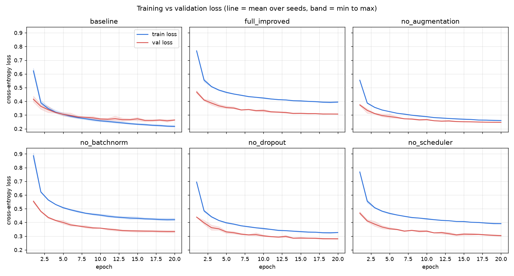
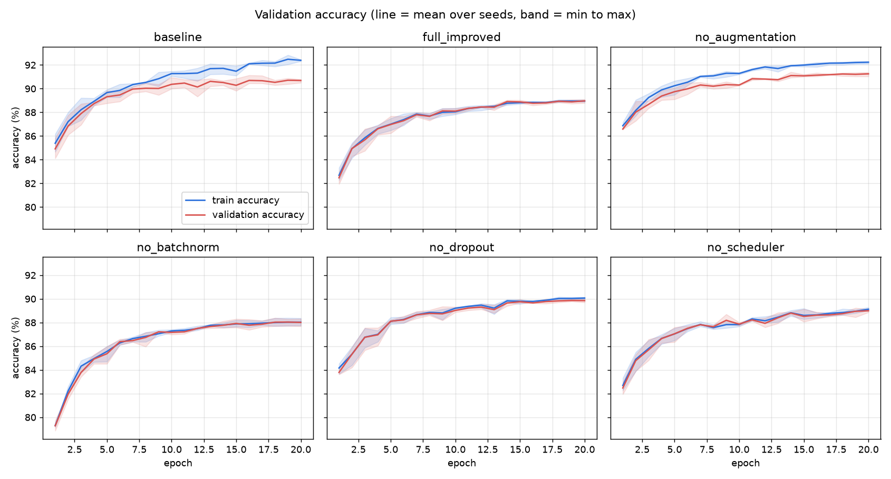
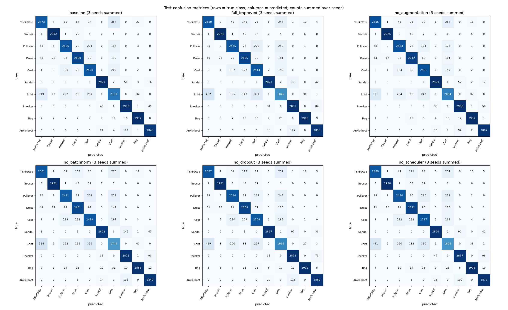
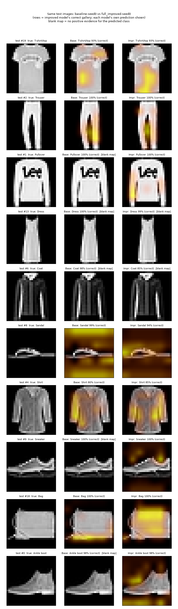
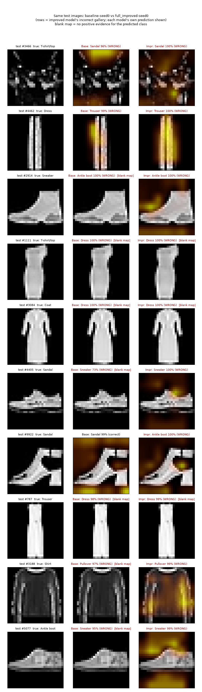

# Engineering report: Emma Rogoveanu

> Team numbers are the official saved records (group `fashion-official-1`, runs 53–70); the SQL tables come from the Supabase SQL-editor export.

## What I owned
I built the foundation and serving side: the CNNs, reproducible training, the experiment runner, the Supabase schema, the five-tab dashboard and the prediction log. When we found that the project used the starter's synthetic shapes instead of Fashion-MNIST, I carried out the correction and ran the 18 official runs in an AI-assisted session on my machine; that work is not Komal's.

## Design decisions
**Reproducibility first.** Each run records its seed, split hash and plan fingerprint. The protocol was frozen before any official run: 54,000 training images, a seeded 6,000-image validation set, the 10,000 official test images, 20 epochs, batch 128, Adam at 0.001, seeds 0–2. The checkpoint is the lowest-validation-loss epoch.

**Atomic prediction logging.** Each prediction writes its image hash, label, probabilities and producing run in one database function; if logging fails, the API returns an error, not a result.

**Honest serving.** The served model, `full_improved-seed0` (run 54), was chosen before results were known and is not the most accurate (87.82%).

## Results I rely on
Over three seeds the baseline reached 89.73% ± 0.47 test accuracy and the full improved model 88.10% ± 0.29. The improved model did not beat the baseline: the baseline was 1.62 points higher (95% interval +0.26 to +2.99). Removing augmentation gave the best variant (90.30%); removing batch normalization cost 0.98 points, so only it helped.

My reading is that the network (about 9,000 parameters) is capacity-limited: `full_improved` ends with training and validation accuracy both near 89%, so it is not over-fitting, while the baseline reaches 92.39% and 90.69%. Augmentation and dropout seem to cost more than they save in 20 epochs.

**Curves, confusion matrices and per-class precision/recall** (test split, mean or sum over three seeds; [per-class table](../experiments/results/fashion-official-1-analysis/per_class_metrics.csv)). Shirt is weakest: baseline precision and recall 0.71, improved 0.69 and 0.62.

Temperature scaling, fitted on validation only, lowered test calibration error in five of six variants.

## Grad-CAM: both models, and two failures
I generated 10 correct and 10 confident-error overlays for the baseline (run 53; regenerated accuracy 90.01%, equal to the stored value) and for the improved model (run 54), and showed both on the same 20 test images. Where maps exist, both models light parts of the garment for T-shirts, trousers and shirts, and mostly background for sandals. The main difference is blank maps: the baseline's predicted-class map is blank for every Dress, Coat, Sneaker and Ankle boot prediction and 73% of Pullover; the improved model's is blank for 98% of Dress and 88% of Coat. A blank map shows only that this method found no positive evidence; **it does not show that no region supports the class**. Saliency shows sensitivity, not cause, so I do not use it to explain either model's accuracy. The maps are 7×7. The written comparison is an AI draft that has not been reviewed.

**Failure 1: Sneaker #2914 predicted Ankle boot (99.9%).** The baseline makes the same error (blank map), which, with the tall upper, looks like a **dataset** failure: at 28×28 a high-top sneaker and a low boot differ by a few pixel rows. Confidence did not flag the ambiguity.

**Failure 2: Trouser #787 predicted Dress (99.3%).** Both models predict Dress and both maps are blank. I read this as a **model/method** limit: the logit seems driven by absent cues that a positive-evidence map cannot show. This is untested.

## Limits and what I would do differently
- Three seeds give wide intervals; most tests are mocked.
- **Light-background bias.** In supplementary probes after the official evaluation (not benchmark results; 10 bundled images, run 54), a white background pushed 8 of 9 non-bag images to Bag, often above 0.99. Try It now warns before upload.
- The dataset error was caught late; next time I would read the full assignment first.

## Ethical reflection
**Where harm could occur.** In medical triage a confident wrong label delays care; in surveillance or moderation a label attaches to a person who cannot contest it, and a plausible heatmap lends false credibility. 

**Two safeguards before shipping.** Technical: rate limits and authentication, plus a pre-upload privacy notice; **none is implemented** and CORS is open. Governance: out-of-scope uses stated in the model card, and a retention and contact policy, **not yet defined**. Implemented today: hash-only logging, hash-free anonymous views and generic errors.

**What we chose not to log.** Pixels, thumbnails, Grad-CAM images, filenames, EXIF data, IP addresses, user identifiers and request bodies. A hash plus the probability vector lets us audit without keeping what people upload, which could be faces or documents. Hosting providers' own logs were not inspected.

## Worldview reflection
I am a Christian. A classifier pointed at people exercises power over image-bearers: "So God created man in his own image" (Genesis 1:27, ESV). A label on a person is a claim about someone who carries that dignity, made without consent and hard to contest.

**The use I would refuse to build:** retraining this pipeline on photos of people to infer identity, emotion, health or group membership, or to flag individuals in a camera feed. Fashion-MNIST is safe because its subjects are garments; with other labels the same code would be surveillance.

**Why the refusal is engineering.** It shows in the system: ten garment classes only, "any decision about people" out of scope in the model card, and hashes instead of pixels so the service cannot become an archive of faces. The gap is that no technical control stops someone retraining the code on people. Our refusal is a boundary, not a lock.

## AI use
I used Claude Code and Codex, recorded in `ai-usage/`. I ran the tests and official runs, applied migrations 004 and 005, and checked the results.
