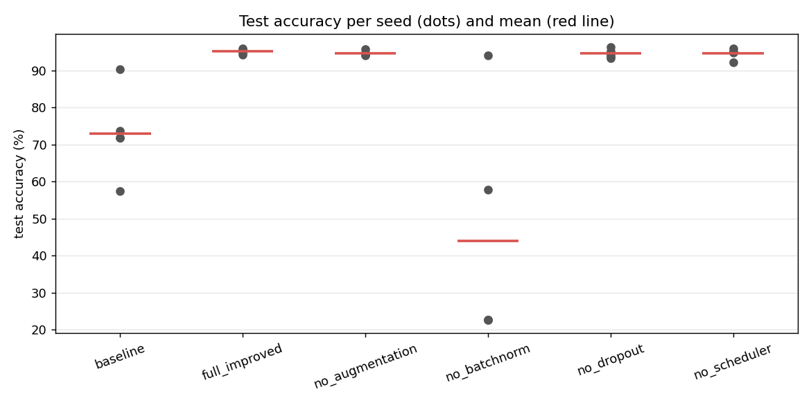
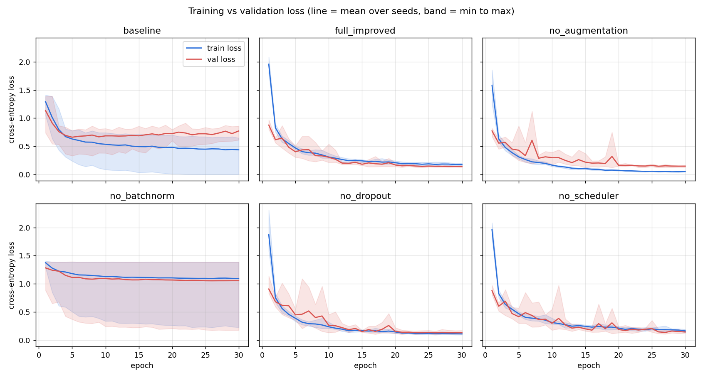
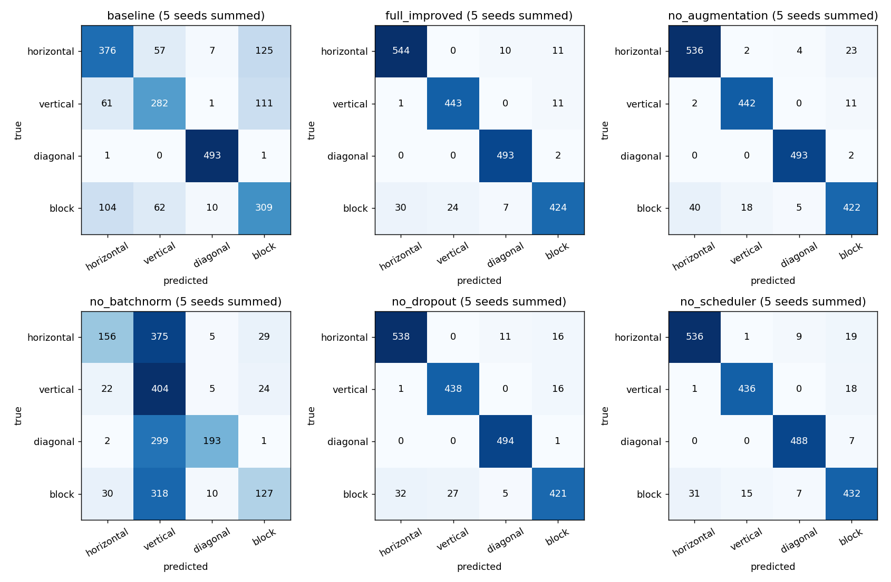
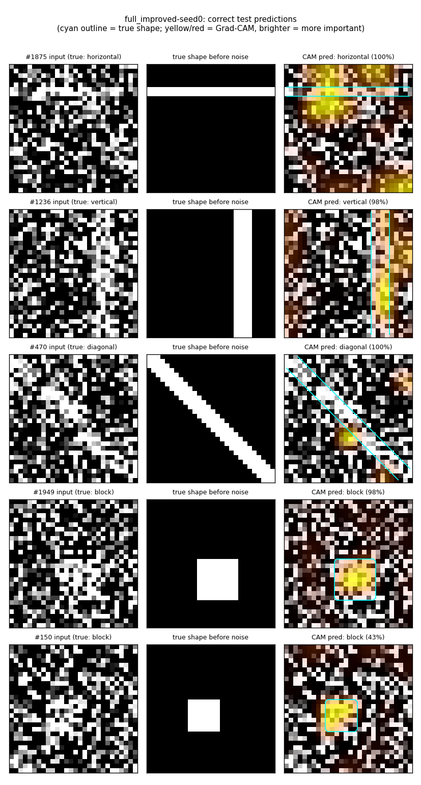
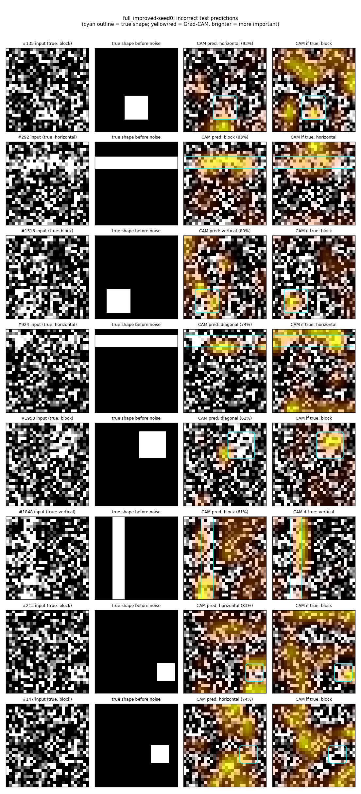

# Part 2 results: baseline vs improved CNN and ablations

> **HISTORICAL (synthetic shapes) — not the final evidence and not Fashion-MNIST.** This is the report of the first experiment, on the
> four-class synthetic-shape dataset (`official-1` / `official-supabase-1`), preserved unchanged below this note. The final report for
> the Fashion-MNIST experiment is [PART2_RESULTS.md](PART2_RESULTS.md). Its numbers must never be read as Fashion-MNIST results.

Experiment group `official-1`: 6 configurations × 5 training seeds = **30 runs**,
all under the protocol frozen in [PART2_PROTOCOL.md](PART2_PROTOCOL.md) before
any test result existed. The task is 4-class shape classification on 28×28
images (2000 images, noise 1.0; 1400 train / 200 validation / 400 test). Every
run keeps its lowest-validation-loss epoch, and the test set is scored once.

> **Where these runs live.** The runs were made through the real API
> (`POST /train`, read back with `GET /runs/{id}`) using the offline database
> (`SEE_SENSE_LOCAL_DB`), on a Linux CPU machine. The numbers below come from
> running `docs/comparison_queries.sql` **unchanged** on a Postgres engine
> (PGlite) with migrations 001 + 002 applied (`experiments/sql_check.mjs`). They
> were then checked against a separate Python recomputation (0 mismatches).
> Emma will repeat the same frozen protocol on Supabase. Expect small numerical
> differences on another machine (see [RUN_API_LOCALLY.md](RUN_API_LOCALLY.md) §5b).

## 1. Headline results (SQL queries 4–5)

| Variant | Test accuracy (mean ± sd, 5 seeds) | Macro-F1 | Test loss |
|---|---|---|---|
| **full_improved** | **95.20% ± 0.69** | 0.951 ± 0.007 | 0.141 ± 0.010 |
| no_augmentation | 94.65% ± 0.68 | 0.947 ± 0.007 | 0.161 ± 0.019 |
| no_scheduler | 94.60% ± 1.40 | 0.946 ± 0.014 | 0.131 ± 0.021 |
| no_dropout | 94.55% ± 1.20 | 0.945 ± 0.012 | 0.147 ± 0.026 |
| baseline | 73.00% ± 11.64 | 0.722 ± 0.129 | 0.619 ± 0.213 |
| no_batchnorm | 44.00% ± 31.80 | 0.358 ± 0.386 | 1.053 ± 0.533 |

Per seed (test accuracy):

| Variant | seed 0 | seed 1 | seed 2 | seed 3 | seed 4 |
|---|---|---|---|---|---|
| baseline | 71.75% | 71.75% | 90.25% | 73.75% | 57.50% |
| full_improved | 94.75% | 94.25% | 96.00% | 95.50% | 95.50% |
| no_augmentation | 94.25% | 94.50% | 94.75% | 94.00% | 95.75% |
| no_batchnorm | 57.75% | 22.75% | 94.00% | 22.75% | 22.75% |
| no_dropout | 96.25% | 93.75% | 93.25% | 94.25% | 95.25% |
| no_scheduler | 94.75% | 92.25% | 96.00% | 95.00% | 95.00% |



## 2. Each technique's contribution (SQL query 6)

Each ablation is compared with `full_improved` **of the same seed**, so the
data, split, initial weights and batch order are identical and only the one
technique differs. pp = percentage points. The interval is a paired t
interval over 5 seeds; with this few seeds it is a rough guide.

| Removed | Δ accuracy per seed (pp) | Mean Δ (pp) | 95% CI (pp) | Seeds worse than full |
|---|---|---|---|---|
| augmentation | −0.50, +0.25, −1.25, −1.50, +0.25 | **−0.55** | [−1.57, +0.47] | 3 of 5 |
| dropout | +1.50, −0.50, −2.75, −1.25, −0.25 | **−0.65** | [−2.57, +1.27] | 4 of 5 |
| LR scheduler | 0.00, −2.00, 0.00, −0.50, −0.50 | **−0.60** | [−1.62, +0.42] | 3 of 5 |
| batch norm | −37.00, −71.50, −2.00, −72.75, −72.75 | **−51.20** | [−90.28, −12.12] | 5 of 5 |
| *baseline (architecture + all four)* | −23.00, −22.50, −5.75, −21.75, −38.00 | **−22.20** | [−36.37, −8.03] | 5 of 5 |

### What this does and does not show

- **Augmentation, dropout and the LR scheduler: no clear effect.** Removing
  each one lowered mean test accuracy by only 0.55–0.65 pp. That is less than
  one standard deviation across seeds (0.7–1.4 pp) and only 2–3 test images out
  of 400. Every 95% interval includes zero, and in some seeds removing the
  technique *improved* accuracy (dropout +1.5 pp on seed 0; augmentation
  +0.25 pp on two seeds). With this protocol, **we cannot say these
  techniques help**; any real contribution is smaller than the seed-to-seed
  noise. Test loss tells the same mixed story: removing the scheduler gave a
  slightly *lower* mean test loss (−0.009).
  - The loss curves do show augmentation working as a regulariser:
    without it, training loss falls to ≈0.05 while validation loss stays
    ≈0.14, a much bigger gap than in `full_improved` (≈0.17 vs ≈0.13). That
    reduced overfitting did not turn into a measurable test-accuracy gain here.
- **Batch norm: very large effect, mostly through training stability.**
  Without batch norm, **3 of 5 seeds never started learning**. Their training
  loss stayed at 1.386 = ln(4) from the first epoch (the network gave equal
  probability to all four classes) and they predicted "vertical" for every
  test image, hence exactly 22.75% (91 of 400 images are vertical). On the two
  seeds that did train, batch norm still helped (−2.0 and −37.0 pp). So at
  learning rate 0.01, batch norm is what makes training **reliable**. The
  −51 pp average mostly measures failed optimisation, not a generalisation
  benefit.
- **Baseline vs full_improved (−22.2 pp)** changes the architecture *and*
  all four techniques at once, so it is not attributable to any single one.
  The baseline is also unstable at this learning rate. Seed 2 reached 90.25%,
  while seed 4's training loss never fell below about 0.65 and it reached only 57.5%.
- **Leave-one-out caveat:** each ablation measures a technique's
  contribution *given the other three are on*, not its effect on its own.

## 3. Training and validation curves (SQL query 3)



- `full_improved`, `no_dropout`, `no_scheduler`: training and validation loss
  fall together to ≈0.13–0.17, with no overfitting. Best epochs are late (20–29),
  so the 30-epoch budget is used.
- `no_augmentation`: a clear train/validation gap (overfitting), discussed above.
- `baseline`: validation loss bottoms out around epoch 5 and then rises while
  training loss keeps falling (overfitting). Best-validation-epoch selection
  is what keeps its test score from being worse. The wide band shows how much
  the seeds differ.
- `no_batchnorm`: the band runs from a normal curve (seed 2) to a flat line at
  ln(4) (seeds 1, 3, 4).

## 4. Confusion matrices (SQL query 7)



For the four well-trained variants, `diagonal` is almost never confused (it is
the only class with oblique edges). Nearly all remaining errors are **`block`
confused with `horizontal` or `vertical`**. For example, `full_improved` over
5 seeds has 96 errors in total: block→horizontal 30, block→vertical 24 and
vertical→block 11. The Grad-CAM failures below explain why. The baseline
confuses horizontal, vertical and block with each other broadly. The
collapsed `no_batchnorm` seeds put every image in the vertical column.

## 5. Grad-CAM evidence

Model: `full_improved-seed0` (test accuracy 94.75%, 21 of 400 wrong). The
test split was regenerated from the dataset and split seeds, and re-scoring it
reproduces the stored accuracy exactly, so these are genuine test predictions.
Overlays use `predict_with_cam`, the same function as `POST /predict`. The
**cyan outline** marks where the true shape was drawn before noise was added.
It comes from replaying the generator's random-number stream; the model never
sees it. Script: `experiments/gradcam_evidence.py`; probabilities are in
`experiments/results/gradcam/examples.csv`.

**Five correct predictions** (one per class, plus the least confident correct one):



For the block (#1949, #150) and vertical (#1236) examples, the heatmap sits on
the true shape. For horizontal (#1875) and diagonal (#470), it covers only
part of the line (one segment of the bar, and a short stretch of the diagonal),
plus some background noise. The model needs only a confident fragment of a
line to classify it, which is also the source of its errors. #150 is correct
but uncertain (43% block, 30% diagonal, 26% horizontal).

**Eight incorrect predictions** (one per distinct confusion type, most confident first):



### Failure 1: #292, true horizontal → predicted block (83%)

The heatmap for "block" sits **on the true horizontal bar**, but only on its
left and middle part, where the noise happened to leave a dense, bright,
roughly rectangular cluster. Toward the right the bar is broken up by dark
noise pixels and gets little weight. The model looked in the right place but
misjudged the shape's *extent*. It saw a short, thick bright patch rather than
a line running across the whole image, and a short thick patch is what a block
looks like. This is the horizontal/block confusion in §4: under heavy noise,
the only cue separating a bar from a block is whether the bright region spans
the full width, and noise can hide that.

### Failure 2: #135, true block → predicted horizontal (93%)

Here the heatmap for "horizontal" is **not on the block**. The strongest
response is a band **below** the block, near the bottom edge, where a chance
run of bright noise pixels forms a short horizontal streak. The block itself
(about 8×8 pixels) gets only weak weight. The map for the true class, block, is
scattered over several noise blobs across the image, with only part of it on
the real block. The model was confidently wrong because it latched onto a
spurious feature in the background. The small block gave weaker evidence than
a random streak in the noise. Examples #147 and #213 show the same pattern:
small blocks (about 6×6 pixels), and heatmaps spread over the background
instead of on the block.

**What Grad-CAM adds:** the two failures have different causes. #292 is the
right region with the wrong interpretation; #135 is the wrong region. Accuracy
numbers alone can't tell these apart. In both cases, a confident heatmap
is not proof the model is right. #135 was wrong at 93% confidence.

## 6. Limitations

- **Single machine, offline database.** These 30 runs are not yet in
  Supabase. The same frozen protocol must be rerun there (Emma), and results
  can differ slightly across machines.
- **Exploration didn't cover the unstable variants.** The budget search used
  baseline, full_improved and no_scheduler. It did not check whether
  `no_batchnorm` trains reliably at learning rate 0.01, and the baseline looked
  stable on the two exploration seeds. The instability shows up only in the
  official runs. Following the frozen protocol, we did **not** change any
  setting after seeing the results. A follow-up study could use a lower
  learning rate (0.003 was stable for the baseline in exploration) with more
  epochs, or add learning-rate warm-up.
- **Few seeds and a small test set.** With 5 seeds and 400 test images (1 image
  = 0.25 pp), differences under about 1–2 pp can't be distinguished from noise.
- **Synthetic task.** Noise 1.0 was chosen to stop every model reaching 100%.
  The conclusions are about this toy task and this protocol, not about these
  techniques in general.
- **Untuned scheduler:** cosine over the full 30 epochs. Dropout (0.3) and
  shift (1 px) were tuned on 2 exploration seeds only.

## 7. Reproduce

```bash
# API (offline DB) in one terminal:
SEE_SENSE_LOCAL_DB=.local_db.json uvicorn api.main:app --port 8000
# register dataset (id 2 on a fresh local DB), then the official run: see PART2_PROTOCOL.md
python -m experiments.run_experiments ... --expect-fingerprint cf05f954...

# SQL on local Postgres (needs: npm install @electric-sql/pglite@0.2.17 in some folder,
# copy experiments/sql_check.mjs there):
SEE_SENSE_ROOT=$PWD node <that folder>/sql_check.mjs .local_db.json official-1 experiments/results/official-1-sql 1,2,3,4,5,6,7
python -m experiments.analyze experiments/results/official-1-sql experiments/results/official-1-analysis
python -m experiments.gradcam_evidence .local_db.json full_improved-seed0 official-1 experiments/results/gradcam
```

On Supabase: paste queries 1–7 into the SQL editor (group `official-1`),
export each result as `q<N>.csv`, and run `experiments.analyze` on that folder.

## Files

| File | What |
|---|---|
| `docs/PART2_PROTOCOL.md` | frozen protocol and the validation evidence behind it |
| `experiments/explore.py`, `experiments/results/explore_*.jsonl` | exploration (validation only) |
| `experiments/results/official-1-console.txt`, `official-1-runs.jsonl` | runner output for the 30 official runs |
| `experiments/results/official-1-sql/q1..q7.csv` | SQL query results |
| `experiments/results/official-1-analysis/` | `summary.md` and the three figures |
| `experiments/results/gradcam/` | Grad-CAM figures and `examples.csv` |
| `experiments/sql_check.mjs`, `experiments/analyze.py`, `experiments/gradcam_evidence.py` | the scripts |
